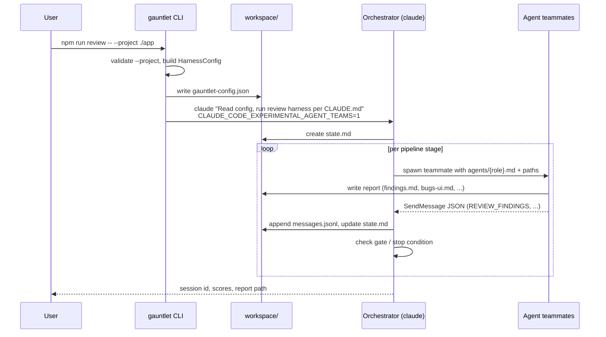
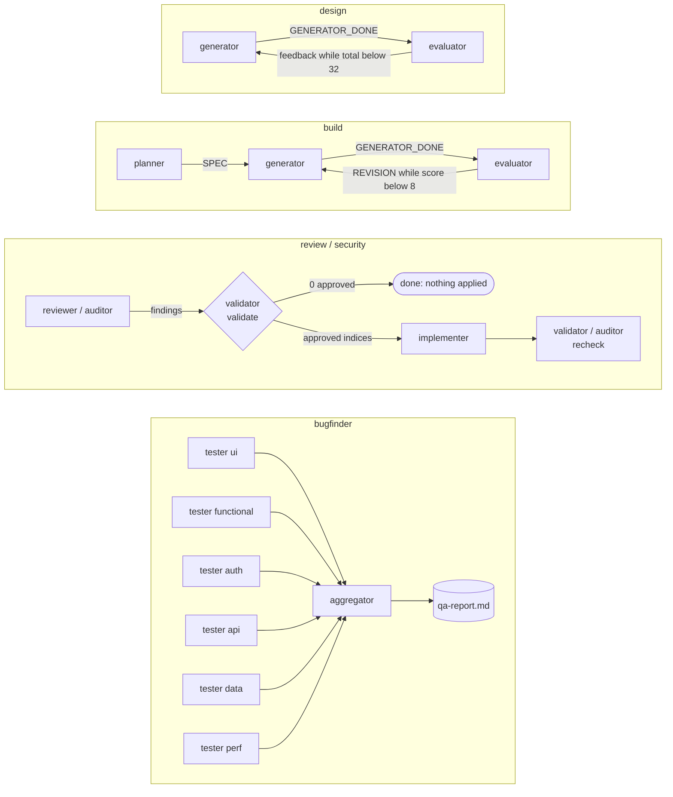

# Architecture

Gauntlet is a thin TypeScript CLI in front of a Claude Code session that acts as
**Lead Orchestrator**. The CLI decides *what* to run and writes it down; the
orchestrator follows a written protocol (`CLAUDE.md`) to spawn specialised
agent teammates, route their messages, and stop when a gate or a threshold says
so. Every agent's behaviour lives in a markdown file, every hand-off is a typed
JSON message, and every artifact lands in `workspace/`.

## Layers

| Layer | Files | Responsibility |
|---|---|---|
| CLI | `src/index.ts`, `src/cli.ts` | Parse argv, validate paths, print the banner, launch |
| Config | `src/config.ts` | Pure builders: options → `HarnessConfig` per mode |
| Protocol (executable) | `src/protocol.ts` | Pipelines, targets, stop conditions, Validator gate, aggregation invariants |
| Runtime | `src/runtime.ts` | The only side effects: workspace dir, config file, `claude` process |
| Contracts | `src/types.ts` | `HarnessConfig` and every inter-agent message type |
| Protocol (prose) | `CLAUDE.md` | What the orchestrator does, step by step, per mode |
| Agents | `agents/*.md` | One role each; frontmatter declares modes and emitted messages |
| Skills | `skills/*.md` | Claude Code entry points that run a mode |
| Browser helper | `scripts/browser.js` | Playwright runner the tester agents call |

`CLAUDE.md` is what actually runs. `src/protocol.ts` states the same rules as
data so they can be unit-tested, and `test/protocol-sync.test.ts` fails CI if
the two disagree (agents spawned per mode, thresholds, message types, gate).

## Launch sequence

The CLI exits non-zero *before* launching when a required directory or file is
missing, or when `--focus` contains no valid area. It never calls Claude in
tests: `createProgram` takes a `Runtime`, and the suite injects an in-memory one.

## Roles

| Agent | Modes | Emits | Writes |
|---|---|---|---|
| planner | build | `SPEC` | `spec.md` |
| generator | design, build | `SPRINT_CONTRACT`, `GENERATOR_DONE` | `design-output.html` or the app |
| evaluator | design, build | `DESIGN_SCORE`, `EVALUATION` | `evaluation-{n}.md` |
| reviewer | review | `REVIEW_FINDINGS` | `findings.md` |
| auditor | security | `SECURITY_AUDIT`, `RECHECK` | `vulnerabilities.md` |
| validator | review, security | `VALIDATION`, `RECHECK` | `validation.md` |
| implementer | review, security | `IMPLEMENTATION_DONE` | edits to the target project |
| tester | bugfinder | `BUG_REPORT` | `bugs-{area}.md`, `screenshots-{area}/` |
| aggregator | bugfinder | `BUG_AGGREGATION` | `qa-report.md` |

The orchestrator itself sends one message type, `REVISION` (build mode: priority
fixes + context hand-off back to the generator).

## Pipelines per mode

| Mode | Stages | Stops when |
|---|---|---|
| `bugfinder` | N testers **in parallel** (one per focus area) → aggregator | all N `BUG_REPORT`s received, then `BUG_AGGREGATION` |
| `review` | reviewer → validator (validate) → *gate* → implementer → validator (recheck) | gate closed, or `RECHECK` received |
| `security` | auditor → validator (validate) → *gate* → implementer → auditor (re-audit) | gate closed, or `RECHECK` received; target risk ≤ 3/10 |
| `design` | generator ↔ evaluator loop | total ≥ 32/40, plateau, or `--iterations` (default 15) |
| `build` | planner → (generator ↔ evaluator) sprints | `passed` or score ≥ 8/10, or `--sprints` (default 5) |

## Gates

- **Validator gate** (review, security). The validator checks each proposed fix
  for accuracy, correctness, blast radius and scope, then returns
  `VALIDATION { approved[], rejected[], ready_to_implement }`. The implementer
  runs only if at least one fix is approved, and applies only the approved
  indices. `validatorGate()` and `validateValidationMessage()` in
  `src/protocol.ts` encode this; the tests cover the closed gate, index
  bounds and contradictory `ready_to_implement`.
- **Recheck.** After implementation, a second pass (validator in review mode,
  auditor in security mode) re-reads the modified files and reports
  `RECHECK { passed, remaining_issues }`.
- **Score thresholds.** Design ≥ 32/40, build ≥ 8/10, bugfinder quality ≥ 8/10,
  security risk ≤ 3/10 (`TARGET_SCORES`).
- **Plateau.** The evaluator flags a design plateau when the last three totals
  are within ±1 and the latest is ≥ 28 (`detectPlateau()`).
- **Aggregation invariants.** Duplicates carry `duplicate_of` and are excluded
  from counts; the quality score must fall in the rubric band for the counts
  (`validateAggregation()`).

## Data passed between agents

Agents never share memory. They share **files in `workspace/`** and send
**small JSON messages** to the orchestrator, which owns the state.

| Artifact | Producer | Consumer |
|---|---|---|
| `gauntlet-config.json` | CLI | orchestrator, `status` |
| `state.md` | orchestrator | humans, `npm run status` |
| `messages.jsonl` | orchestrator (append-only, one message per line) | audit / debugging |
| `spec.md`, `sprint-{n}-contract.md`, `evaluation-{n}.md` | planner, orchestrator, evaluator | generator |
| `findings.md` / `vulnerabilities.md` | reviewer / auditor | validator, implementer |
| `validation.md` | validator | implementer, recheck |
| `bugs-{area}.md` | testers | aggregator |
| `qa-report.md`, `design-final-{session}.html` | aggregator, orchestrator | user |
| `iterations/design-{n}.html` | orchestrator | best-iteration selection |

The message shapes are TypeScript interfaces in `src/types.ts`
(`AgentMessage` is the union). Each agent's markdown file contains its output
contract, and the sync test checks it shows every type it declares.

## Failure handling

| Failure | Behaviour |
|---|---|
| Bad CLI input (missing `--project`, path not found, no valid focus area) | Exit 1 before any Claude launch; nothing written except `workspace/` dirs |
| Validator rejects everything | Gate stays closed, project untouched, session ends with the report |
| Implementer cannot apply a fix cleanly | Fix is skipped and listed in `IMPLEMENTATION_DONE.skipped` / `summary`, never forced |
| Applied fix is wrong or incomplete | `RECHECK.passed = false`, `remaining_issues` counts it |
| Score never reaches target | Loop ends at the iteration / sprint cap or on plateau; the best design iteration is kept |
| Tester cannot reach the app | Tester tries to start it from the project scripts; see `docs/TROUBLESHOOTING.md` §5 |
| Session hangs | `state.md` and `messages.jsonl` show the last step; usually a pending permission prompt (§6) |

There is no automatic retry of a whole session: each run gets a fresh session
id and rewrites `gauntlet-config.json`, so archive `workspace/` if you need an
old run's reports.

## What is and is not tested

`npm test` (node:test, no network, no Claude) covers CLI → config wiring for
every mode, the pure protocol functions, the definition lint and the
`CLAUDE.md` ↔ `protocol.ts` sync. Agent *judgement* (whether a reviewer finds
the right bugs) is not unit-testable; it is constrained by the prompts, the
Validator gate and the recheck.
